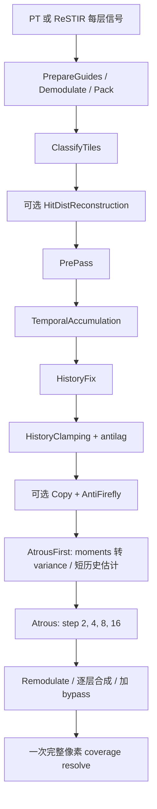

# RELAX → Ocarina 嵌入式 DSL 移植设计

设计日期：2026-10-12；开工/评估：2026-10-16。状态：完整实现和场景证据已落地，17 项相关回归通过；待独立整分支审查。实现分支：`feat/relax`；直接基线：`svgf_magic@f8a5ceb33f201e748ad69bcdfc7ab3afebc24371`。

## 1. 目标与边界

用户要求参照 RTXPT 和 NRD，把 RELAX 算法用 Ocarina 嵌入式 DSL 实现，并从 `svgf_magic` 建立新分支。成功条件是能在现有渲染管线选择 ReLAX，运行完整降噪链路，并有真实 GPU 测试、图像对照、性能和显存证据。

建议首版覆盖 `RELAX_DIFFUSE_SPECULAR` 的全分辨率 RGB 路径：普通 PT、ReSTIR，以及最多三层 stable planes。实现顺序先 PT 后 ReSTIR，但仅 PT 通过不代表完整范围完成。用户于 2026-10-16 授权按此范围施工。

- 沿用 `Kernel`、`Float/Float3/Uint`、`$if/$for`、`OC_PARAM_STRUCT`、`BufferDesc`、`Shader<void(Param)>`、`device().compile()`、`CommandBatch`。
- 完整保留镜面虚拟重投影、快慢历史、History Fix、History Clamping/antilag、可选 AntiFirefly、方差估计和 À-trous。
- SVGF 继续可选，保持当前默认；最终 coverage resolve 保留，和 RELAX 光照历史分离。
- 首版 checkerboard OFF；包含 hit-distance reconstruction OFF/3×3/5×5，默认 OFF，仅在 producer 满足采样前提时启用。
- 首版不覆盖 SH/SG、AO/SO、SIGMA、光场 SSAT、动态分辨率升采样、新的形变运动系统；普通 resize、相机运动及已有玻璃分层必须支持。
- 不扩展现有稳定平面的输运范围。粗糙玻璃、厚曲面折射继续受现有一阶近似限制。

## 2. 核实的源码基线

| 来源 | 固定提交 | 用途 |
| --- | --- | --- |
| CoronaEngine `svgf_magic` | `f8a5ceb33f201e748ad69bcdfc7ab3afebc24371` | 唯一实现基线；本地与 `origin/svgf_magic` 一致 |
| `D:/work/utils/RTX-Path-Tracing` | `21ef566cb37ef832438375fb3b5bd0b170e52f7c` | 信号准备、stable plane、demodulation/remodulation、最终合成 |
| RTXPT `External/Nrd` | `16a64cd4daebfb153590623f0348b36007284ba3`，NRD 4.14.3 | RELAX 公式、pass 图、默认参数和资源寿命 |
| `D:/work/renderers/NRD` | `b50c3cb575e3dfcc9bfe9933f511da1bf70a4f96`，NRD 4.15.1 | 仅作差异核查，不混用新版字段或输出约定 |
| 引擎 `.workspace/Horizon` | `2607a3b380e526fb3c319168493119d9b93285d3` | 实际编译使用的 Ocarina；不修改旁边的独立 ocarina checkout |
| CoronaEngine `feat/reblur` | `afb9aea194391d20552caa089ed854e9b760f490` | 只读参考 producer 拆分、材质因子、coverage-only 和测试经验 |

RTXPT 工作区有其他修改；参考时以固定提交的内容为准。其 `External/Nrd` 工作区已核实干净。执行前重新记录所用文件哈希及局部 diff。保留实际翻译文件的 NVIDIA notices 和适用 LICENSE。

官方入口：[RTXPT](https://github.com/NVIDIA-RTX/RTXPT)、[NRD](https://github.com/NVIDIA-RTX/NRD)。具体依据均为上表本地固定版本。

## 3. 方案选择

| 方案 | 代价与结果 | 结论 |
| --- | --- | --- |
| 逐 pass 翻译 RELAX，用现有 DSL 调度 | 能保留算法语义和项目后端；需要补齐 producer 数据 | **推荐** |
| 基于 SVGF 加部分 RELAX 启发式 | 较快，但缺失独立快慢历史、虚拟重投影和完整历史修复；无法按 RELAX 验收 | 不采用 |
| 直接接入 NRD SDK/HLSL | 需要额外资源与后端集成，也不符合用户指定的 DSL 实现 | 不采用 |

不整体合并或 cherry-pick `feat/reblur`：该提交包含 REBLUR 滤波器及其专用命名。仅在本次必需的文件中移用经验证的信号准备逻辑，使用中性的 `denoiser_*` 命名；RELAX 的滤波公式仍来自固定 NRD 源码。

## 4. 现有代码的实际缺口

| 位置 | 当前事实 | 本次改动 |
| --- | --- | --- |
| `vision/src/base/denoiser.h` | `ChannelKind` 区分 PT diffuse/specular 与 ReSTIR direct/indirect | 增加显式 lobe 输入和能力查询，保留原通道语义 |
| `vision/src/base/integral/integrator.cpp` | PT 已拆颜色，但 `.w=1`，未提供真实 lobe hit distance | 分离 bypass，记录命中距离、正确的混合 BSDF 分量 |
| `vision/src/render_core/integrator/ReSTIR/` | DI/GI 并非 diffuse/specular；已有三层身份与虚拟几何 | 在贡献产生处拆 lobe，而非事后猜测两张混合图 |
| `vision/src/base/scattering/material.*`、`lobe.*` | 需要对复合材质和实际采样方向核对 lobe 归属 | 只补充拆分、方向相关材质因子和 guide 所需接口 |
| `vision/src/base/sensor/frame_buffer.*` | 已有有界层视图；descriptor offset 有既有约束 | 按需分配显式 lobe/bypass 输出，保持有界指针视图 |
| `vision/src/render_core/denoiser/SVGF/` | 当前空间核为固定 Poisson；已有完整像素 coverage resolve | 新建独立 ReLAX；仅复用 coverage 所需逻辑 |
| `src/systems/optics/vision/vision_render_mode_config.cpp` | 非 SSAT 会把 denoiser type 重写为 svgf | 保留显式 ReLAX 选择，保持未指定时的默认行为 |
| `vision/src/apps/vision-eval/main.cpp` | 有固定 60 Hz 仿真、轨迹、线性输出、RMSE 与阶段计时 | 作为实际场景验收入口；补充的诊断仅服务本任务 |

## 5. 输入、时间与输出契约

新增 `DenoiseLobeInput`，包含 `BufferView<float4>` 类型的 diffuse/specular radiance-hitdist 与 filtered output 视图；`RealTimeDenoiseInput` 增加 `has_lobe_signals` 和 `lobe_signals`。`Denoiser::requires_lobe_signals() const noexcept` 默认 false，ReLAX 返回 true。现有 raw direct/indirect 保留原含义。

| 数据 | 精确含义 |
| --- | --- |
| radiance | 线性、未曝光的 RGB；producer 按实际 BSDF 求值分给 diffuse/specular；两者加 bypass 等于原总辐射 |
| 输入 `.w` | 世界单位 hit distance，0 表示缺失距离；有效黑色样本和缺失 lobe 必须可区分。不能沿用 SVGF 的 `.w=1` |
| RELAX pack | 按 `RELAX_FrontEnd_PackRadianceAndHitDist` 保留 RGB 与非归一化 hit distance；按源码清理 NaN/Inf、负值并限制到 65504。不能套用 REBLUR 前端 YCoCg/normalized-hit-distance 编码 |
| 材质因子 | 在输入准备中除去、输出中乘回同一方向相关 BSDF factor；stable prefix throughput 纳入一次；复合 Plastic/Substrate 同时支持两个 lobe |
| normal/roughness | 世界空间 shading normal；stable 层使用一致的虚拟空间法线。现有 `reuse_material` 的 roughness 已是 sqrt(alpha)，标量采用 `sqrt(rx*ry)`，不重复开方 |
| viewZ | 无 jitter view 变换得到的轴向深度；stable 层从其 depth-position 求 viewZ。不能用 Euclidean distance 代替；physical/virtual/depth position 不混用 |
| motion | 当前已有二维量是 current-minus-previous、像素单位；转换到 NRD 所用 UV 位移为 `-motion_pixels/resolution`。像素中心、jitter 只补偿一次 |
| 身份 | branch sequence、instance hash、depth、material、valid；layer slot 本身不足以证明历史相关 |
| 时间 | 使用 `Pipeline::frame_delta_ms()`，按固定源码准备 framerateScale、旋转采样等常量；首帧无有效 dt 时使用 1000/60 ms。测试固定 dt，不用 GPU 耗时代替仿真时间 |
| 输出 | remodulated lobe RGB；`.w` 在内部各阶段分别可能为 hit distance、二阶矩、variance，不透传成统一语义；最终合成只消费规定的 RGB |

hit distance 从当前降噪表面之后开始；按 RTXPT `StablePlaneAccumulateSampleHitT` 处理首段与最多三个 delta-only 段，按 `StablePlaneCombineWithHitTCompensation` 处理有效贡献合并。缺失但有 BSDF 支持的 lobe 可用独立 guide ray 补足距离；guide ray 不能重复添加能量或扰动原估计器的随机数维度。有效黑色样本的距离不能因为零 luminance 被丢弃。

ReSTIR 在 DI/GI 贡献产生处依实际 BSDF 比例拆分，先应用原 DI/GI factor，再合并成两个 lobe；合成不再次乘 factor。factor 变化使相关历史失效。主可见 emission/sky、确定性 stable-prefix 辐射旁路；反射路径看到的发光体仍属于被降噪信号。

## 6. 完整算法与源码映射

| 本项目阶段 | NRD 4.14.3 依据（相对 External/Nrd） | 必须保留 |
| --- | --- | --- |
| 调度与常量 | `Source/Denoisers/Relax_DiffuseSpecular.hpp`、`Source/Relax.cpp` | 资源读写顺序、首/末轮区别、reset、时序常量与默认参数 |
| Classify/Reconstruct/PrePass | `Shaders/Source/RELAX_ClassifyTiles.cs.hlsl`、`Shaders/Include/RELAX_HitDistReconstruction.hlsli`、`RELAX_PrePass.hlsli` | 空 tile、3×3/5×5、几何/lobe 权重及 tracking distance |
| TemporalAccumulation | `Shaders/Include/RELAX_TemporalAccumulation.hlsli` | surface/virtual reprojection、曲率/视差、bicubic footprint 与 bilinear fallback、confidence、快慢历史与二阶矩 |
| HistoryFix/Clamping | `Shaders/Include/RELAX_HistoryFix.hlsli`、`RELAX_HistoryClamping.hlsli` | 短历史重建、快慢历史颜色夹取、加速/重置；内部颜色变换按源码保留 |
| AntiFirefly | `Shaders/Include/RELAX_Copy.hlsli`、`RELAX_AntiFirefly.hlsli` | 独立只读输入避免邻域读写竞争；默认关闭 |
| AtrousFirst/Atrous | `Shaders/Include/RELAX_AtrousSmem.hlsli`、`RELAX_Atrous.hlsli` | 首轮方差、短历史空间估计、variance 传播、roughness/normal/depth/luminance 权重和最后一轮输出规则 |
| 公共数学 | `Shaders/Include/RELAX_Common.hlsli`、`Common.hlsli` 及用到的 MathLib helper | 仅移植实际使用函数，注明来源与测试 |

首版默认沿用该版本：慢历史 diffuse/specular 各 30、快历史各 6，historyFixFrameNum=3，historyFixBasePixelStride=14，spatialVarianceEstimationHistoryThreshold=3，prepass 半径 30/50，phiLuminance=2/1，colorBoxSigmaScale=2，À-trous 5 轮（step 1/2/4/8/16，可配置 2–8 轮），AntiFirefly=false。其余核心权重按对应 `RelaxSettings` 移植，不借用 SVGF 阈值。

上游首轮使用 shared memory 是实现优化；可先以等价 buffer taps 保持相同公式与边界语义。现有 DSL 已有 block barrier/warp vote；不能假定有未经验证的 HLSL gather/shared-array 等价接口。纹理 point/linear/clamp、12-tap bicubic 的 buffer 实现需独立数值验证。优化前后必须使用同一输入对比。

首版不提供外部 confidence/disocclusion-mix 输入，选择固定源码相应的“输入不存在”路径；保留 RELAX 自身计算的 specular reprojection confidence。遵循该版本默认 specular motion V2，并把凹面镜局限列入质量报告。

## 7. 文件组织、历史与显存

新建 `vision/src/render_core/denoiser/ReLAX/`：`relax.{h,cpp}` 管理插件/生命周期；`filter.{h,cpp}` 管理层状态与共享 scratch；`config.h`、`utils.h` 放参数与数学；`modulator.cpp`、`prepass.cpp`、`temporal_accumulator.cpp`、`history_fix.cpp`、`history_clamping.cpp`、`atrous.cpp` 分别实现阶段。AntiFirefly 和安全 copy 归入 history_clamping.cpp；不新增通用 render graph。

- 每层独立慢/快 RGB 与 moment 历史、reflection hitT、history length、previous normal/roughness/viewZ/identity。
- 各层顺序调度，共享 current guides、prepass 与 ping-pong scratch；当前临时数据不得按三层永久复制。
- 先完成上一帧所有邻域读取，再发布本帧历史。按 NRD pass 顺序可在 Temporal 完成后发布颜色历史；reflection hitT 等仍被同 pass 读取的数据使用独立 current/previous 存储。
- À-trous 最终显示结果不写回 slow/fast history；coverage 结果也不回流。遵循源图的反馈位置。
- 不按同一大结构双缓冲所有字段；FP32 运算和初始存储，先盘点 `sizeof×像素×层数`，再决定实际 scratch alias。
- 仅按上游永久资源的 FP32 对应估算，4 个 float4、2 个 float hitT、history length、normal/roughness、material、viewZ 就约 100 B/像素/层；三层 1080p 约 593 MiB，尚不含 branch 身份、scratch、producer 与引擎其他内存。这是容量估计，不是测量结果。
- 空层需清当前输出并使历史失效；重现时不能读取旧亮度。部分 tile 的越界线程必须按 barrier 规则参与同步。
- resize、frame gap、camera cut/投影突变、scene invalidation、启停、stable-plane 开关清相关历史；正常相机移动使用重投影。
- 最小改动复用 SVGF coverage-only 能力（参考 feat/reblur 的实现），避免为了 coverage 分配 SVGF 的完整 illumination history；主路径保持原行为。

## 8. 分阶段验收

1. **输入契约**：CPU 期望值与真实 GPU pack/sampling helpers 对比；复合材质 lobe 和、有效黑色距离、HDR、零 roughness、jitter/motion/viewZ 往返成立。
2. **单层 pass**：固定小尺寸 fixture 覆盖常量保持、几何边界、短历史修复、光照突变、虚拟运动、无效 tap、2/5/8 轮 À-trous；检查历史更新位置与有限值。
3. **PT 集成**：raw 与未过滤 lobe+bypass 能量一致；完整 RELAX 能显式选用，关闭后与基线一致；不会被 framebuffer accumulation 掩盖。
4. **ReSTIR/三层**：DI/GI 开关和非 0/1 权重、层交换/消失/重现、玻璃反射透射、branch 变更、相机横移均有真实 shader 回归；各层历史隔离。
5. **场景证据**：固定 Kitchen/材质与镜面/玻璃 fixtures，1 spp，静态 64 帧及至少 96 帧移动/停止序列。保存 raw、SVGF、ReLAX 的线性 PFM/PNG、配置、种子、相机姿态及高 spp 参考。
6. **质量边界**：静态报告全图及 diffuse/glossy/edge ROI RMSE、时间噪声；移动指标只与相同姿态参考比较。静态噪声 ROI 应优于 raw；与 SVGF 的退化项、blur、拖影必须单列，不能只看全图平均宣布胜出。新增合成 fixture 对光照突变恢复和 disocclusion 首帧做确定性断言。
7. **性能**：报告同 GPU 的 720p/1080p，PT/三层 ReSTIR；分列 guide-ray 成本、每个 RELAX pass、coverage、总帧、CPU shader 编译时间、实际新增 buffer 字节及 device-wide 峰值。同步阶段计时注明口径，不等同于纯 GPU timestamp。

无用户指定的帧预算或目标显卡，先同机测量，不预先承诺快于 SVGF 或所有场景质量更优。8 GiB 类设备的三层 1080p 容量必须单独检查，不能用较低分辨率通过替代。

## 9. 完成定义与当前状态

完成需要：完整 RGB 链路 + PT/ReSTIR/三层集成 + 相关 CTest 回归 + CLion 同环境 `corona_engine` 构建 + 真实场景图像/指标 + 性能/显存表 + 来源及支持边界说明。只构建成功或只出现降噪图像不算完成。

完整 RGB 管线、PT/ReSTIR/三层接入与评估已实现于 `feat/relax`。详细配置、实测退化、逐阶段耗时和 8 GiB 容量限制见 [ReLAX README](../../../vision/src/render_core/denoiser/ReLAX/README.md)。独立整分支审查已完成，两项 Important 问题（折射 depth anchor 混用、极暗/黑色 ReSTIR 端点丢失）均经 GPU RED→GREEN 修复于 `12dcaa2f`。修复后 17 项相关回归通过（75.50 s），64 个评估任务重新通过，包含两组独立 2048 spp 参考；CLion 同环境引擎构建通过。最终证据校验包含 renderer 指纹、实际 buffer 字节、逐层历史 pass 和每帧一次 coverage。8 GiB 三层 1080p 平均约 636 ms、device-wide 峰值 7883 MiB，容量余量/无换页未获认证。分支及独立 worktree 保留。
